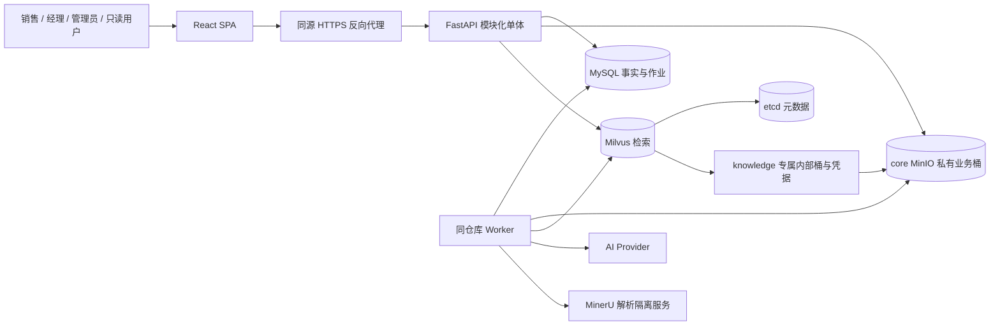
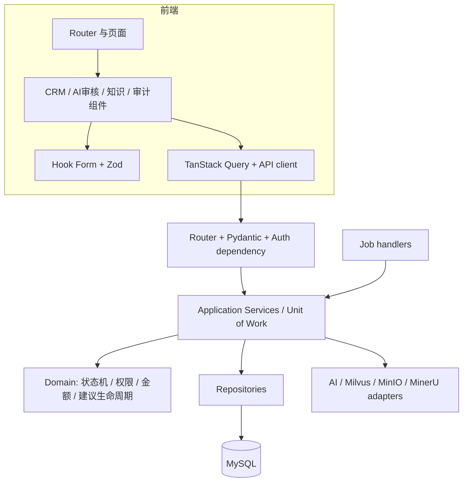
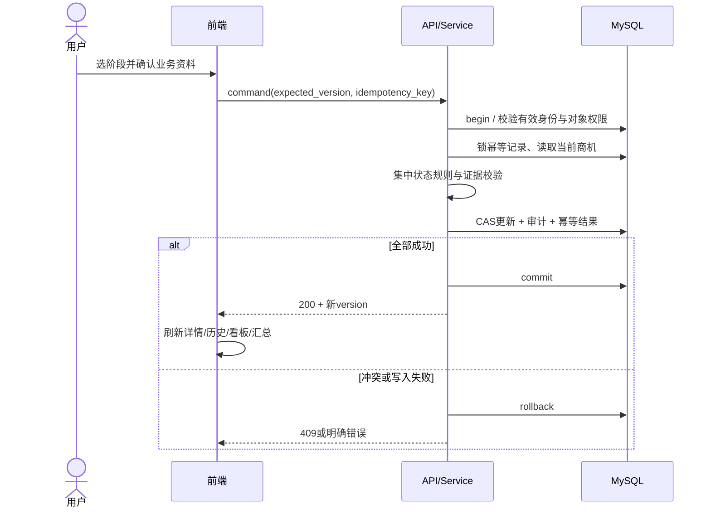
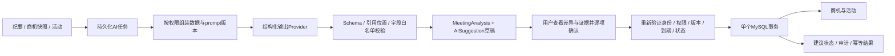
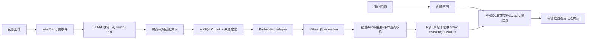
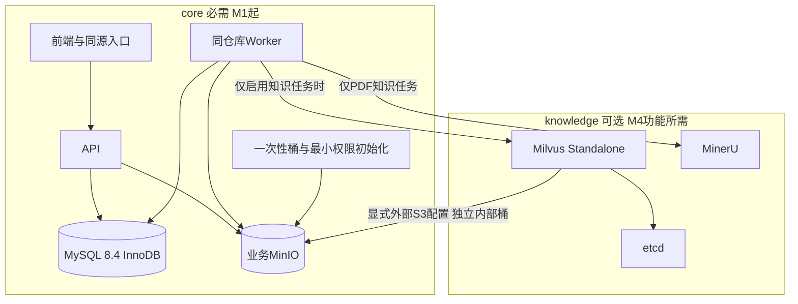

# 系统架构与故障边界

状态：第二轮设计提案 v0.2 · 2026-10-26。业务和权限总规则见 [technical-design.md](technical-design.md)。

实施状态：M1正式验收通过；Q03—Q06已批准；用户于2026-10-27明确授权开始M2。Q11仅成交证据PDF≤20 MiB/≤100页获批，Q12仅成交证据API代理下载、每次重新鉴权获批；Q05-A、Q07—Q10及Q11/Q12其余范围继续待确认。实施与未完成项见[M2报告](m2-report.md)，不自动进入M3。
## 1. 系统上下文

API 和 worker 是同一业务应用的两种进程，worker 不是独立业务微服务。MySQL 存全部可恢复业务状态；Job 表是轻量持久化调度，不用 FastAPI 内存 background task 承诺可恢复性。Milvus Standalone 的标准 Compose 包含 etcd 与 MinIO，需明确整合它们；本项目复用core MinIO，不部署第二个默认MinIO，详见§9；实际组合在M1固定版本后验证。[Milvus 官方部署说明](https://milvus.io/docs/install_standalone-docker-compose.md)

## 2. 模块与依赖方向

router 只做协议、身份和错误映射；schema 校验类型/长度；domain 定义不变量；service 协调权限、事务和审计；repository 执行查询/CAS，不 commit；adapter 隔离供应商异常。前端生成类型可来自审核后的 OpenAPI，但生成类型不能代替后端授权。模块间通过服务接口协作，不从 AI router 直接调用 ORM 写商机。

每个请求/任务独享 Session，不跨线程共享。建议同步 SQLAlchemy + PyMySQL，API 同步 handler 在 FastAPI 线程池执行；worker 同步数据库短事务与外部 HTTP 解耦。并发上限受数据库池、模型配额和解析资源限制，不能无限创建线程。

## 3. 商机状态变更链路

不在事务中请求模型或对象存储。成交证据上传/持久化确认在前置独立流程完成，关闭事务只读不可变 evidence 元数据及核验状态；不能因 MinIO 临时失败部分完成关闭。

## 4. AI 数据流与受控执行

生成与执行分离。生成时冻结业务快照版本、输入文本 hash、prompt/schema/provider 版本；模型看不到会话/密钥。任务结束时再次核对商机版本，发生变化则建议 STALE。审核页面提交选中 change IDs，不提交自由 patch。任务被取消/建议过期后，晚到的模型结果只能被丢弃或作为不可执行历史，不能重新激活草稿。

## 5. 文档发布与检索链路

MySQL、MinIO、Milvus 没有跨系统 ACID 事务；不能声称一次 commit 覆盖三个服务。用确定性对象键、chunk ID、generation ID、幂等 upsert、持久化 Job 和发布指针实现最终一致性。索引写入成功但发布失败时旧版本继续提供服务，重试校验后再切换；发布后清理旧 generation。更新重建期间保留旧的可用版本，展示“更新处理中”。

删除事务先设 document=DELETING、撤销检索可见性并 enqueue DELETE job；worker 分阶段删除向量、块原文、解析结果与业务原件，核对后标 DELETED。Job 失败保持不可检索与错误状态，管理员可重试；不能因为外部清理失败恢复成 READY。Milvus 可能短时返回旧向量，API 必须过滤已删除/旧 generation。当前引用返回授权时再检查可见性，禁止直接相信向量中的 URL。

历史结果也执行来源复核：建议引用中的quote若源已删除则返回tombstone，不再返回缓存片段；历史知识问答Job若引用源被删则隐藏整段派生答案，返回SOURCE_UNAVAILABLE，不能通过Job缓存绕过删除。此删除流程清理知识原件/索引/块正文，不承诺自动擦除所有已导出或已人工转写的派生业务信息；保留策略须单独确认。数据库中的历史建议证据快照按保留策略管理，对外序列化始终复核来源。

## 6. 作业恢复与并发

Job 保存 type、aggregate_id、dedupe_key、payload_schema_version、status、attempts、available_at、lease_until、lease_token、progress、error_code。worker 用短事务 SELECT FOR UPDATE SKIP LOCKED 领取，到期租约可重新领取。心跳和最终状态写入都验证 lease_token；过期 worker 不允许覆盖新 worker 的结果。外部写按 generation 隔离，发布 CAS 检查租约和 revision，必要清理由对账作业补偿。

初始单 worker：AI 并发2、PDF解析1、embedding批处理1，实测后调整。每 Job 最多3次领取尝试；Provider单次尝试与总任务预算分别限制并记录，避免相乘失控。worker 退出时停止领取并尽量完成或释放租约；进程崩溃后持久化任务可恢复。生成建议以 source_job_id 唯一键去重。清理 job 可人工新建重试，但有审计，不永久循环。

定时对账检查：READY文档的块数/索引版本、DELETING未完成对象、孤儿对象、租约超时Job、建议过期状态；只按可验证关系清理，不做无限全库扫描。

## 7. 外部依赖与故障边界

| 故障 | 可见结果 | 处理/恢复 |
| --- | --- | --- |
| MySQL不可用 | CRM写入/认证503，API readiness失败 | 不缓存伪成功；恢复后检查提交状态，命令用原幂等键重试 |
| AI超时/限流 | job失败原因、可重试；CRM可用 | 有限重试；REAL绝不切换MOCK；用户可显式重新生成 |
| AI非法JSON/引用 | AI_OUTPUT_INVALID，非可执行 | schema修正预算内一次，仍失败留失败状态 |
| embedding不可用 | 新索引失败；问答503 | 已发布文档仍可管理；不混用另一模型向量 |
| Milvus/etcd不可用 | 知识问答503，CRM可用 | 索引任务保留；检查组件一致版本后恢复/重建 |
| core MinIO不可用 | 上传/下载503，知识存储及Milvus可能同时受影响 | 普通CRM可用；不能使用未持久化证据；关闭仅读已持久化核验元数据，不在事务中访问存储 |
| knowledge profile关闭 | UI模块未启用，知识/增强建议503 KNOWLEDGE_DISABLED | core就绪、证据上传核验和M3会议apply不依赖知识服务 |
| MinerU失败/资源不足 | PARSE_FAILED + 可诊断错误 | 限资源、PDF超时、页数保护；不把空文本当成功；TXT/MD不受其影响 |
| worker崩溃 | 任务等待/租约过期，不显示成功 | 新worker接管，最终结果按dedupe约束发布 |
| API响应丢失 | 客户端结果未知 | 幂等重放原结果或重新读取；不再创建副作用 |

health/live 只证明进程存活；health/ready 检查数据库与迁移状态；/capabilities 分模块说明 worker/知识/AI真实或Mock可用性，健康详细信息仅管理员可读。核心就绪不因可选 profile 关闭而失败，但完整 MVP 验收不可跳过知识模块。

## 8. 环境与版本治理

M1已实际构建并运行core，MinIO固定到已核验摘要，其他实际镜像元数据保存在M1补全证据中；本机8.4.13与隔离容器8.4.8均通过真实数据库测试。知识服务及权重在M4前置验证后锁定，Milvus共享对象存储及MinerU适配仍未实施，不能从M1结果推导其兼容性。

部署只对外暴露 HTTPS；本地管理端口绑定127.0.0.1；后台任务、MinIO console和数据库不公开。MVP单机存在单点故障；profile可减少早期开发负担，但不能被称为完整功能替代。

## 9. Compose profiles、共享对象存储与依赖门禁

core包含前端、API、MySQL、Worker、业务MinIO；桶策略初始化和Alembic为受控一次性任务，不是另一套迁移系统。knowledge包含Milvus、etcd、MinerU与锁定版本实际需要的检索客户端/内部组件；embedding由Provider adapter提供，不默认新增外部服务。启用knowledge必须同时启用core。AI_MODE=mock|real为配置维度，不另称mock/real Compose profile。

复用方案：只有一个MinIO服务/数据卷，归core管理。业务桶esc-evidence、esc-knowledge、esc-parsed、esc-export与Milvus专属esc-milvus-internal分离；Milvus用独立服务账号，仅限该内部桶的必要List/Get/Put/Delete及所锁版本所需分段上传操作；业务账号不能读写Milvus桶，Milvus账号不能访问业务证据。桶创建和策略授权由独立初始化账号完成，运行时禁root/桶管理/策略管理权限；密钥不进入前端、日志或仓库。

Milvus配置须显式覆盖minio.address（core服务DNS，如business-minio）、port、accessKeyID/secretAccessKey（专属secret）、bucketName=esc-milvus-internal、rootPath=milvus、useSSL及可信证书。跨主机必须TLS；隔离本机Compose网络可显式禁SSL，不能误配协议。正式配置键/环境变量映射以M1锁定release核验；使用该release的user配置挂载，不能假定只修改一个环境变量便覆盖全部默认值。标准Milvus Compose自带MinIO，整合时必须移除重复服务/卷定义，并改为显式依赖core对象存储；不会自动复用应用MinIO。[官方Compose](https://milvus.io/docs/install_standalone-docker-compose.md)、[对象存储配置](https://milvus.io/docs/configure_minio.md)

启动顺序：MySQL/MinIO健康→一次性Alembic升级与桶策略初始化→API/Worker；启用knowledge再等待etcd、共享MinIO桶与凭据、Milvus/MinerU就绪。API核心readiness只检查MySQL/迁移；文件、Worker、AI、knowledge逐项在capabilities报告可用性与原因。core故障时UI显示连接不可用；knowledge关闭或故障显示模块禁用/暂不可用，不能显示空知识库或虚假成功；Worker不领取关闭模块的新任务，不加载知识客户端阻塞CRM启动。

验收：M1验证core独立启动和共享存储配置路径；M2只启core完成证据上传/核验/关闭；M3只启core完成会议人工审核执行/审计；M4启core+knowledge完成真实Milvus写入、重启读取、PDF解析、权限负例与引用删除。停knowledge只停止其服务，保留core MinIO/卷和初始化资源，不执行整个项目down或删除共享卷；知识停用不应中断CRM/会议执行。共享实例仍是容量与故障共同边界，监测空间并分别管理配额/备份，不能将桶隔离称为故障隔离。当前仅为设计，均未部署验证。
