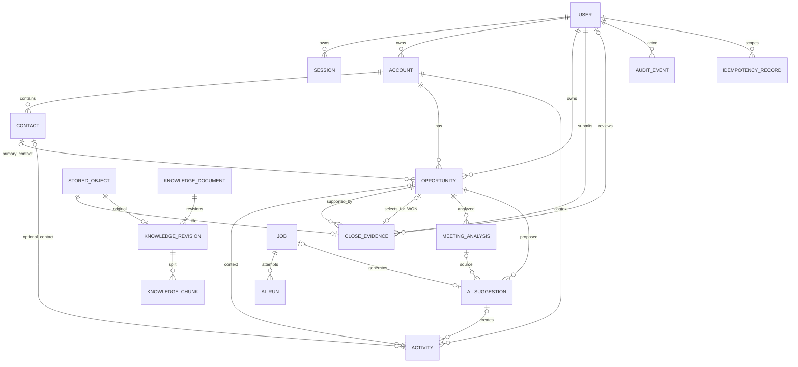

# 数据模型与业务不变量

第二轮设计提案 v0.2 · 2026-10-26。数据库基线为 MySQL 8.4 / InnoDB，技术基线已依本轮指令确定（ADR-01/02），Q04/Q05/Q06已批准，Q05-A及Q07—Q12仍待确认。以下是逻辑设计，不是已创建的迁移。

实施状态：设计、技术栈与Q03已批准，本轮Q04/Q05/Q06已批准，其余未批准事项继续待确认；仅同步文档，未授权M2开发。M1仅迁移User/Session/AuthThrottle；其他表未创建。M1 UUID用VARCHAR(36)实现，其他逻辑约束不变；完整CRM模型仍为后续设计，见 [M1报告](m1-report.md)。
## 1. 通用约定

- ID：CHAR(36) ASCII UUID，主键；API 按字符串表示。FK 默认 RESTRICT，不级联删除业务历史。
- 除明示可空外字段 NOT NULL。C/U 表示 created_at/updated_at DATETIME(6)，UTC，由服务端设置；所有可变聚合有 version BIGINT UNSIGNED，初值1。
- 字符集 utf8mb4；用户名/邮箱另存规范化小写值并唯一；自然名称不强制唯一，以免阻止真实同名公司/联系人。
- 金额 DECIMAL(18,2)，禁止负数，最大 9999999999999999.99；API 只接收十进制字符串，拒绝指数形式、NaN、多于两位小数；不经 JS Number 或 Python float 运算。
- 状态列 VARCHAR + CHECK，服务 Schema 同步枚举；CHECK 和生成列表达式在真实 MySQL 上验证。业务跨行约束在锁定关联行后检查，不能只依赖请求校验。
- JSON 只用于有 schema_version 的草稿、证据与脱敏审计，不取代 CRM 正规关系字段。列表大字段按需加载。
- 逻辑停用/归档不隐式改变业务状态；被引用的 User/Account/Contact 不物理删除。敏感日志与审计无密码、token、API key。

## 2. ER 图

AuditEvent 的 entity_type/entity_id 是多态历史引用，不做对每种业务表的 FK；actor_id 可空只供系统任务，actor_kind=SYSTEM 时必须记录 job_id。图中默认省略 created_by 等重复用户连线。KnowledgeDocument 与 active revision 形成发布指针，迁移时分步添加 FK。

## 3. 身份与 CRM

### User

| 字段 | SQL类型/约束 | 含义 |
| --- | --- | --- |
| id | UUID PK | 不复用 |
| name | VARCHAR(100) | 显示名称 |
| email / email_normalized | VARCHAR(254)，后者 UNIQUE | 登录标识；不允许空白邮箱 |
| password_hash | VARCHAR(512) | Argon2id编码串，不进入常规响应 |
| role | VARCHAR(24) CHECK | ADMIN / SALES_MANAGER / SALES_REP / READ_ONLY |
| is_active | BOOLEAN | 停用立即拒绝新会话和写入 |
| password_changed_at | DATETIME(6) | 凭据撤销与安全展示 |
| version、C/U | 通用 | 管理操作CAS |

索引：(role,is_active,id)。禁止普通API删除。最后一个有效管理员变更须锁定统一管理守卫行（SystemGuard: key='active_admin', version），串行校验，防止两个管理员同时停用彼此。User 更新与会话撤销、审计同事务。

### Session

id UUID PK；user_id FK；token_hash BINARY(32) UNIQUE；csrf_nonce BINARY(32)；created_at/last_seen_at/idle_expires_at/absolute_expires_at DATETIME(6)；revoked_at nullable。索引(user_id,revoked_at)、(absolute_expires_at)。cookie仅保存随机会话token，明文不持久化；CSRF token由服务端密钥HMAC(session_id + csrf_nonce)派生，login/me可以返回，无需反解hash。过期/撤销会话不能被幂等重放恢复权限。last_seen节流更新，不能令每个GET产生高频写锁。

AuthThrottle为认证限流专用小表：key_hash BINARY(32) PK（账号规范化值/来源的带密钥hash）、window_start DATETIME(6)、failed_count INT、blocked_until nullable、expires_at；原子递增，索引expires_at并定期清理。生产多API进程共用MySQL状态，不使用单进程字典声称共享限流。登录预认证限流与失败日志采用独立短事务，不与业务命令混合；真实阈值在M1确定并测试，不能永久锁死账户。

### Account

| 字段 | 类型/约束 |
| --- | --- |
| id、owner_id | UUID PK、User FK，owner必须有效销售角色 |
| name | VARCHAR(200)，trim后非空 |
| industry | VARCHAR(100) nullable |
| website | VARCHAR(2048) nullable，http/https且仅存储不抓取 |
| company_size | VARCHAR(24) nullable，SOLO/SMALL/MEDIUM/LARGE/ENTERPRISE |
| description | TEXT nullable，≤10000字符 |
| is_active | BOOLEAN default true |
| version、C/U | 通用 |

索引(owner_id,is_active,id)、(name,id)。客户停用须无开放且未归档商机，和新建/转阶段操作按客户行→商机行锁序串行协调。停用不改联系人和终态历史，禁止向停用客户新建商机/活动；重启由经理处理并审计。

### Contact

id UUID PK；account_id FK；name VARCHAR(100)；title VARCHAR(100) nullable；email VARCHAR(254) nullable；phone VARCHAR(40) nullable；decision_role VARCHAR(24)=DECISION_MAKER/CHAMPION/INFLUENCER/USER/PROCUREMENT/UNKNOWN；is_active BOOLEAN；version、C/U。

索引(account_id,is_active,name)、email；UNIQUE(id,account_id)供组合FK。联系人不跨企业移动；停用仍保留既有primary引用并显示已停用，不能被新选为主联系人。Opportunity(account_id,primary_contact_id) 对应 Contact(account_id,id) 组合FK（建立同序唯一索引），服务层另检有效状态。邮箱不强制唯一，一个企业可有共享邮箱。客户停用不级联删除联系人。

### Opportunity

以下AI可提议字段为Q07待确认提案，不因本次Q04—Q06批准而获准执行；probability禁止人工/AI覆盖则已由Q06明确批准。

| 字段 | 类型/约束/维护者 |
| --- | --- |
| id / name | UUID PK / VARCHAR(200)非空；用户维护 |
| account_id | Account FK，创建后不可更换；防止跨企业历史与引用错配 |
| primary_contact_id | UUID nullable，同客户Contact组合FK；用户或AI有据提议 |
| owner_id | User FK；仅经理/ADMIN修改 |
| stage | VARCHAR(32)五阶段CHECK；仅领域命令更新 |
| amount | nullable DECIMAL(18,2)，默认NULL，CHECK(amount IS NULL OR amount>=0)；预计金额，用户或AI有据提议；未知与已知零区分 |
| currency | CHAR(3) NOT NULL DEFAULT CNY，CHECK IN(CNY,USD,EUR,HKD)；用户维护，AI提议范围仍待Q07批准 |
| probability | SMALLINT CHECK 0..100；仅可信后端由统一阶段映射维护，非独立业务输入；创建/PATCH/AI均不可覆盖 |
| weighted_amount | nullable DECIMAL(18,2) GENERATED STORED，CASE WHEN amount IS NULL THEN NULL ELSE ROUND(amount*probability/100,2) END |
| source | VARCHAR(32)，WEBSITE/PARTNER/REFERRAL/CAMPAIGN/EVENT/COLD_OUTREACH/EXISTING_CUSTOMER/OTHER/UNKNOWN |
| priority | VARCHAR(8)，LOW/MEDIUM/HIGH |
| expected_close_date | DATE nullable，预计不是实际关闭日期 |
| close_reason_code | VARCHAR(32) nullable，BUDGET/COMPETITOR/NO_DECISION/PRODUCT_FIT/TIMING/OTHER |
| close_reason | VARCHAR(2000) nullable；LOST必填非空 |
| close_evidence_id | CloseEvidence FK nullable；WON必填，同商机有效VERIFIED证据 |
| close_evidence_type / close_evidence_reference | 不重复存储，详情从不可变证据关系投影，避免两份真相 |
| closed_at / closed_by | DATETIME(6) / User FK，均nullable；终态必填 |
| is_archived / archived_at / archived_by | BOOLEAN + nullable时间/User FK，仅终态归档 |
| version、C/U | 通用；每次商机事实更新严格+1 |

CHECK：阶段概率映射一致；开放态 closed_at/closed_by、close_reason、close_evidence_id 均空；WON必须evidence，不要求预计amount非空或>0、LOST必须原因，两个终态不能同时具备另一终态的专有字段；is_archived=true仅终态。跨表“证据已核验且属于商机”和owner有效性用服务锁定校验。CloseEvidence提供 UNIQUE(id,opportunity_id)，可用复合FK约束证据归属。关联创建/核验与关闭采用一致锁序。

索引：(is_archived,stage,currency,id)、(owner_id,is_archived,stage,id)、(account_id,created_at,id)、(expected_close_date,id)、(closed_at,stage,currency)、(updated_at,id)。name前缀搜索优先，关键词包含搜索在MVP小规模允许受限扫描并测EXPLAIN，不声称普通BTree可加速任意%词%。

最近活动时间通过批量聚合 occurred_at 读取，避免每卡N+1；MVP不另存可漂移的last_activity字段。商机变更是审计版本单位，新增活动不增加商机version；跟进建议需额外冻结context_as_of和activity digest，执行创建任务时核验相关任务去重，UI明确活动可晚于草稿。

### Activity

| 字段 | 类型/约束 |
| --- | --- |
| id/account_id/opportunity_id/contact_id | UUID；account必填；opportunity/contact可空 FK且必须同企业 |
| type | CALL/MEETING/EMAIL/NOTE/TASK |
| subject / content | VARCHAR(200) / TEXT≤20000字符 |
| occurred_at | DATETIME(6)，事实活动必填；TASK可空 |
| due_at / assignee_id | nullable DATETIME(6)/User FK；TASK必填 |
| status / completed_at | RECORDED/OPEN/DONE/CANCELLED；非TASK仅RECORDED；DONE有完成时间 |
| created_by | User FK，从身份确定 |
| source_suggestion_id / source_change_id | nullable UUID/VARCHAR(64)；AI创建时必填 |
| version、C/U | 通用 |

UNIQUE(source_suggestion_id,source_change_id)防止重复执行任务/笔记。索引(opportunity_id,occurred_at,id)、(account_id,created_at)、(assignee_id,status,due_at)。组合FK或服务锁检验account/contact/opportunity归属。关闭商机可追加记录/完成已有任务，不允许借活动修改冻结商机字段。编辑活动按version审计，不物理删除，纠正原因必填。

## 4. 成交证据与文件

### StoredObject

id UUID PK；bucket VARCHAR(100)；object_key VARCHAR(512) UNIQUE(bucket,object_key)；storage_version_id VARCHAR(200) nullable；original_name VARCHAR(255)；mime_type VARCHAR(100)；size_bytes BIGINT>0；sha256 BINARY(32)；purpose=KNOWLEDGE/CLOSE_EVIDENCE/PARSED/EXPORT；status=UPLOADING/AVAILABLE/DELETE_PENDING/DELETED/FAILED；uploaded_by FK；created_at、deleted_at nullable。

API代理流式上传，服务端生成对象键并限制字节数；只有存储持久化确认并核对hash后才能AVAILABLE。对象写入与DB失败之间可能产生孤儿，Job按保留窗口对账清理；不能把预生成object key当作已存在文件。业务证据和原件不可覆盖，MinIO版本控制与备份配合。

### CloseEvidence

id UUID PK；opportunity_id FK；type=SIGNED_CONTRACT/PURCHASE_ORDER/OTHER_APPROVED；stored_object_id UNIQUE FK；reference_number VARCHAR(100)；customer_legal_name VARCHAR(200)；document_date DATE；amount DECIMAL(18,2)>0；currency CHAR(3)；status=PENDING/VERIFIED/REJECTED；submitted_by FK；reviewed_by nullable User FK；reviewed_at nullable DATETIME(6)；verification_note VARCHAR(2000) nullable；approval_basis VARCHAR(2000) nullable；version、C/U。

证据文件PDF≤20MiB/100页仍为Q11待确认限制，不使用知识库解析结果代替证据核验。Q04已批准：REP可按对象权限准备/提交，只有另一位有效且有对象及核验操作权限的SALES_MANAGER/ADMIN可review（VERIFY或REJECT）；submitted_by由认证身份确定，不允许调用方指定。后端在统一锁序事务内校验角色、权限和submitted_by != reviewed_by，ADMIN不豁免；记录reviewed_by、reviewed_at、status核验结果、verification_note及必要业务依据，同事务追加审计。核对原件、签章/PO、客户主体、编号、金额币种和日期，不宣称法律真实性认证。

约束：PENDING时reviewed_by/reviewed_at/verification_note为空；VERIFIED/REJECTED时这三项非空且说明去空白非空，CHECK(reviewed_by IS NULL OR reviewed_by <> submitted_by)，状态及非空组合另加CHECK。角色/对象/操作权限不能仅靠CHECK或用户ID比较，服务在事务内重新检查有效身份与权限。VERIFIED内容及原件不可改删；被拒后可提交新候选，审核记录不覆盖。WON引用证据不自动清理，最终保留期限仍待Q10确认。

Q05已批准：amount为实际成交金额，必须>0，不要求等于预计金额；预计NULL/零不妨碍满足其余条件的WON。currency非空默认CNY，CHECK IN(CNY,USD,EUR,HKD)；提交、核验和关闭均检查等于商机currency，不符EVIDENCE_CURRENCY_MISMATCH。商机开放期明确修改币种须经CAS；不修改既有证据，币种不再匹配的历史证据不得选定成交。不换汇、不自动改预计值。金额均用Decimal与ROUND_HALF_UP到两位小数；输入超过两位小数拒绝，不静默舍入。

OTHER_APPROVED须approval_basis，不把上传等同于批准。最小可审计提案复用review记录及approval_basis保存批准人/时间/决定引用，不增通用审批流；实际审批责任、步骤与核验人能否兼任审批人仍为Q05-A待确认。该类型可保存PENDING候选；建议未配置经批准审批规则时禁止核验/选定该分支（OTHER_APPROVAL_POLICY_PENDING），合同/PO流程不受影响。该细节提案不是用户已批准规则。

actual_amount/actual_currency为Opportunity详情的只读关系投影：WON经close_evidence_id连接选定VERIFIED证据，非WON为null；不新增可独立修改的实际金额列。汇总只计所选证据一次，不累加同商机其他核验证据。关闭事务按统一锁序锁定商机和所选证据，复核归属、核验状态、原件元数据、正实际金额及币种；不要求锁定预计金额相等。

每笔商机close_evidence_id是唯一当前选择，开放时为空，仅WON关闭命令以evidence_id原子设置；同商机可保存多个PENDING/VERIFIED/REJECTED候选，不为opportunity_id添加候选唯一约束。上传/核验不自动选择或替换；WON后禁止再选/换证据。并发关闭由商机version CAS保证至多一次选定，失败时选择、状态、版本、审计一起回滚。

## 5. 知识模型与向量索引

### KnowledgeDocument

id UUID PK；title VARCHAR(200)；source_label VARCHAR(200)；source_url VARCHAR(2048) nullable（不抓取）；uploaded_by FK；status=PROCESSING/READY/FAILED/DELETING/DELETED；active_revision_id nullable FK；active_generation VARCHAR(64) nullable；version、C/U、deleted_at nullable。

索引(status,created_at,id)、(uploaded_by,created_at)。title/source/上传时间是用户可见元数据；全文只按授权读取。MVP知识库对全体有效用户可读，只有经理/ADMIN管理；设计不预先引入未实现的ACL。

### KnowledgeRevision

id UUID PK；document_id FK；revision_no INT；stored_object_id UNIQUE FK；parsed_object_id nullable FK；file_type=TXT/MARKDOWN/PDF；status=QUEUED/PARSING/CHUNKING/EMBEDDING/INDEXING/READY/FAILED/SUPERSEDED/DELETED；parser_name/version VARCHAR(100)；normalizer_version VARCHAR(32)；chunker_version VARCHAR(32)；embedding_provider/model VARCHAR(200)；embedding_dimensions INT；index_generation VARCHAR(64)；content_sha256 BINARY(32)；page_count/chunk_count INT；error_code VARCHAR(64) nullable；error_message VARCHAR(500) nullable；C/U。

UNIQUE(document_id,revision_no)，索引(document_id,status)。更新以新revision处理，不覆盖现有原文；成功后在同事务切换文档active指针，失败仍可读取旧版。文本为空、非法编码/乱码、密码PDF、超限、解析失败分别返回可诊断码；重试新Job，不伪造READY。

### KnowledgeChunk

id UUID PK；revision_id FK；ordinal INT≥0；text MEDIUMTEXT（长度另限）；heading_path JSON字符串数组；page_start/page_end INT nullable（PDF 1起）；start_offset/end_offset INT；token_count INT；text_sha256 BINARY(32)；embedding_model/version VARCHAR(200)；index_generation VARCHAR(64)；created_at。

UNIQUE(revision_id,ordinal,index_generation)，索引(revision_id,index_generation)。字符偏移对应不可变规范化整篇文本，引用同时带hash；PDF页码保留真实页序，不保证印刷页号一致。TXT/MD引用行号由规范化文本计算，无PDF页码。

向量不在MySQL重复存数组，Milvus collection按 embedding profile（供应商+模型+维度+标准化方式+版本）隔离。字段：chunk_id主键、document_id、revision_id、generation、embedding FLOAT_VECTOR(dim)；COSINE，初期HNSW参数以M4基准定，不把索引参数写死为普遍最优。Milvus仅存检索必要标识，引用正文回MySQL读取，防止旧向量内容泄露。

模型/维度/分块变化时新建generation，完整重嵌入、校验并发布；查询只能使用同一embedding profile。双代过渡期间分别检索当前有效profile或整体切换，禁止不同维度/语义向量混搜。MVP选择整库新代构建完成后切换知识库profile，切换前新profile不可对外查询；失败保留旧profile。需一个KnowledgeIndexConfig单行配置（key='active', profile, generation, version），仅受控发布操作更新并审计，避免文档发布混用profile。

删除：MySQL先隐藏→Job删向量/正文/原件→DELETED tombstone。保留历史引用元数据而删除正文，引用显示不可用。若同一StoredObject被其他用途引用则不得清理；MVP不做跨文档文件去重，减少共享删除复杂度。解析生成物中的图片路径不直接暴露公网。

建议/Job中的历史引用快照不作为绕过删除的副本返回：serializer重新检查document状态，已删引用遮蔽quote；知识问答若存在已删来源，隐藏缓存答案，标SOURCE_UNAVAILABLE。已导出或人工复制进业务记录的内容不在知识删除自动擦除范围内，不能将此接口声称为全系统合规擦除。embedding profile重建由受控维护作业发起并记录审计，MVP不开放任意用户更换模型配置的API。

## 6. AI 与任务

### MeetingAnalysis

id UUID PK；opportunity_id FK；submitted_by FK；meeting_date DATE nullable；timezone VARCHAR(64)；input_text MEDIUMTEXT≤50000字符；input_sha256 BINARY(32)；base_opportunity_version BIGINT；status=QUEUED/RUNNING/SUCCEEDED/FAILED；result JSON nullable（Schema v1见技术设计）；source_job_id UNIQUE FK；schema_version/prompt_version VARCHAR(32)；mode=REAL/MOCK；C/U。

输入不可变，修订创建新analysis；原文不进入审计快照，仅记录ID/hash/长度。MeetingAnalysis的详情仅有该商机AI操作权限的人读取；即使CRM全员可读也不默认开放原始纪要。

### AISuggestion

| 字段 | 类型/约束 |
| --- | --- |
| id/opportunity_id/analysis_id | UUID PK/FK/nullable FK |
| suggestion_type | MEETING_UPDATE/FOLLOW_UP |
| proposed_changes | JSON，冻结change IDs、before/value、kind、evidence_refs、dependency_group |
| advisory / evidence | JSON，行动理由、风险、缺失信息；引用源ID/位置/hash |
| base_opportunity_version | BIGINT≥1 |
| context_as_of / context_digest | DATETIME(6)/BINARY(32)，活动上下文；执行前检查关键上下文是否变化 |
| status | GENERATING/DRAFT/REJECTED/ABANDONED/EXECUTED/STALE/EXPIRED/FAILED/SUPERSEDED |
| created_by/reviewed_by | User FK / nullable FK |
| reviewed_at/executed_at/expires_at | DATETIME(6)；expires_at生成成功后24小时 |
| selected_change_ids | JSON nullable，仅执行结果保存 |
| result_version / execution_id | nullable BIGINT / nullable UUID UNIQUE |
| source_job_id | UUID UNIQUE FK；每任务至多一建议 |
| mode/schema_version/prompt_version | REAL/MOCK、VARCHAR(32) |
| error_code / last_attempt_error | nullable VARCHAR(64)/JSON脱敏信息 |
| version、C/U | 通用 |

索引(opportunity_id,status,created_at)、(status,expires_at)。生成时base version固定；CRM更新不全量改建议状态，读取/apply即时判STALE，后台扫到后持久化。expires_at由服务端UTC判定，与前端时钟无关。status=EXECUTED必须execution_id、reviewed_by、executed_at、result_version齐全；失败不能有execution_id。confidence不提供。

MVP每建议仅允许一次部分选择应用：所选全部原子执行，未选项随建议结束，不支持同建议分批执行。需要其余项时重新生成新建议。advisory-only通过ABANDONED reason='acknowledged'记录已阅，不标EXECUTED。客户端不能编辑冻结JSON，修改建议须生成新草稿或走普通手动编辑流程。

### Job

id UUID PK；type VARCHAR(40)；aggregate_id UUID；dedupe_key VARCHAR(200) UNIQUE；payload JSON（仅ID/配置快照，不存密钥）；payload_schema_version VARCHAR(32)；status=QUEUED/RUNNING/SUCCEEDED/FAILED/CANCELLED；attempts/max_attempts SMALLINT；available_at/lease_until DATETIME(6)；lease_token UUID nullable；progress SMALLINT 0..100；error_code/message nullable；created_by nullable FK；C/U。

输出字段：resource_type VARCHAR(64) nullable、resource_id UUID nullable、result_schema_version VARCHAR(32) nullable、result JSON nullable、mode REAL/MOCK nullable。会议/建议任务优先存资源指针，知识问答将KnowledgeAnswer存result，失败无成功result；按任务所有者和目标权限读取，不暴露payload。生成请求dedupe_key还绑定规范请求hash，复用request_token但内容不同返回409 IDEMPOTENCY_KEY_REUSED；新增request_hash BINARY(32)验证。

索引(status,available_at,id)、(status,lease_until)。租约领取和心跳用lease token校验；外部系统是至少一次调用，通过幂等对象ID与最终发布CAS去重，不宣称网络调用只发生一次。

### AIRun

id UUID PK；job_id FK；capability=CHAT/STRUCTURED/EMBEDDING；provider/model VARCHAR(200)；mode REAL/MOCK；attempt INT；prompt_version/schema_version；input_hash BINARY(32)；started_at/ended_at；latency_ms INT；input_tokens/output_tokens nullable BIGINT；estimated_cost DECIMAL(18,6) nullable；cost_currency CHAR(3) nullable；price_version VARCHAR(64) nullable；status；error_code nullable。索引(job_id,attempt)、(started_at,provider)。不保存API key或供应商完整错误payload。

## 7. 审计、幂等与配置

### AuditEvent

| 字段 | 类型/约束 |
| --- | --- |
| id | UUID PK |
| entity_type/entity_id | VARCHAR(64)/UUID，历史多态引用 |
| actor_kind/actor_id/job_id | USER或SYSTEM / nullable User FK / nullable Job FK |
| action | VARCHAR(64)，如 OPPORTUNITY_TRANSITION、SUGGESTION_EXECUTED |
| before_state/after_state | JSON nullable，schema白名单脱敏快照 |
| reason | VARCHAR(2000) nullable，不存原始纪要 |
| expected_version/resulting_version | nullable BIGINT |
| request_id | VARCHAR(64)，服务端生成并透传 |
| mutation_event_key | VARCHAR(200) nullable UNIQUE，如 opportunity:id:version |
| created_at | DATETIME(6) |

索引(entity_type,entity_id,created_at,id)、(actor_id,created_at,id)、(created_at,id)、request_id。商机每次版本变更有一条主mutation审计，通过唯一event key避免重复；同事务可追加建议和活动的独立事件。timeline从审计的状态相关action投影，不重复维护第二份状态历史表。

应用DB账号在audit表只有SELECT/INSERT，无UPDATE/DELETE，迁移账号单独保管；业务路由不提供历史修改。保存前后白名单字段而非整个ORM序列化，不含密码hash/会话/密钥/原始纪要；联系人和客户可包含必要业务PII，读取按角色脱敏。失败尝试用安全日志，不破坏成功审计的事务语义。超级管理员篡改防护属于后续增强。

### IdempotencyRecord

id UUID PK；actor_id FK；scope VARCHAR(200)（route+aggregate）；key VARCHAR(128)；request_hash BINARY(32)；status=IN_PROGRESS/COMPLETED；response_status nullable SMALLINT；response_body nullable JSON（脱敏）；created_at/expires_at DATETIME(6)。UNIQUE(actor_id,scope,key)，索引(expires_at)。IN_PROGRESS只允许存在于当前未提交事务，成功前填完response并改COMPLETED，禁止单独提交处理中行；插入/命令执行/完成结果均在同事务，因此外部不可见持久化“处理中”半成品。并发重复由唯一键等待，死锁/锁超时可返回可重试错误。保存7天后清理；7天外非AI命令不保证历史结果重放，旧版本仍阻止重做同一次状态转换；AI另以EXECUTED永久保护副作用。

SystemGuard与KnowledgeIndexConfig只为最后管理员保护和知识索引代切换使用，不扩展成通用工作流配置平台。阶段概率/成交依据类型MVP为带版本的部署配置（或集中领域常量），只有重新评审发布可以改变；不提供随意调整历史概率的管理界面。

## 8. 必须验证的不变量

1. 商机主联系人、活动联系人/商机必须属于同一Account，关闭证据必须属于同一Opportunity。
2. 任何商机CAS成功后version恰好+1，且同事务有唯一主mutation审计；审计失败则业务不变。
3. WON证据原件AVAILABLE、证据VERIFIED、实际amount>0且有核验人，币种符合已批准Q05规则，submitted_by != reviewed_by且核验人具备相应角色/操作权限；预计可未知/零/与实际不同；LOST有原因/关闭人/时间；开放态无残留关闭字段。
4. 概率按已批准Q06集中阶段映射（PROPOSAL_SUBMITTED=20、NEGOTIATION=60、FOLLOW_UP=40、WON=100、LOST=0），非历史数据校准预测；创建、转换、重开同事务维护并CHECK防漂移；weighted_amount在amount未知时为NULL；Decimal无浮点漂移，汇总不混币种。Pipeline按币种返回已知/未知数量，全未知合计NULL、空集合0、部分未知显示已知小计；WON实际汇总用所选核验证据。
5. EXECUTED建议只有一次execution_id，活动按suggestion+change唯一；过期/旧版本/旧上下文不能apply。
6. 活动上下文变化：生成后新增/编辑/完成相关Activity会改变digest；apply将其判STALE，即使商机version未变化，避免对过时跟进上下文执行。
7. READY文档只发布完整可检索generation；DELETE文档即使向量残留也不可返回正文。
8. owner与角色变动的竞态由命令事务重新读取/锁定用户与对象解决；失活账户不能执行旧草稿或重放受保护结果。
9. 最后管理员约束和客户停用/商机创建竞态以真实锁测试验证，不能仅在前端禁用按钮。

容量/保留：MVP不自动清理业务审计和成交证据；建议原始AI纪要保留90天作为待确认策略，未批准前不实现自动删除。Job/AIRun建议保留30天、幂等结果7天，已执行建议的去重与审计记录不能随Job清理丢失。清理Job时保留tombstone或使用归档而非破坏FK；实际保留策略由评审决定。
