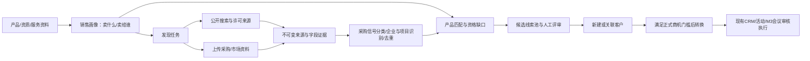

# 商机发现中心：医疗器械场景设计

状态：**设计草案，待评审，不是开发或外部数据传输授权**。日期：2026-10-28。

用户希望在现有CRM之前增加系统入口，通过互联网搜索、知识资料上传等方式寻找商机。本方案以医疗器械销售为示例；中国大陆医院采购仅为本次示例地域，产品、行业、地区均可配置。未实现代码、迁移、上传、爬取或Provider调用；不改变已批准Q03—Q07、Q10及其他待确认决策。

## 1. 产品定位与建议结论

新增一级入口 **“商机发现”**，形成完整链路：

输出的核心是 **“哪个采购主体，可能有什么需求，为什么适合我们，依据在哪里，哪些条件尚不满足，下一步由谁核实”**。搜索结果、匹配结论和CRM正式商机分开存储。未经人工确认，不新建客户/联系人/商机，不发邮件，不提交投标，不外呼，不改变Pipeline。

资料分为两类：产品与公司能力资料回答“我们能卖什么”；采购公告、项目需求、市场资料回答“谁可能买”。上传产品手册本身不会凭空产生真实采购需求，也不能把我方产品功能当成对方需求证据。

## 2. 医疗器械示例与需求边界

### 2.1 示例销售画像

示例产品：医院超声诊断设备及配套交付服务。只用于系统演示，不声明具体品牌、注册类别、上市许可或临床效果。

| 画像内容 | 示例输入及用途 |
| --- | --- |
| 产品/解决方案 | 设备品类、适用销售场景、型号与版本、明确支持/不支持的技术参数 |
| 目标客户 | 公立/民营医院、基层医疗机构、体检机构；经销商机会单独分类 |
| 区域 | 示例为中国大陆，可细化省市；售后服务覆盖以资料为准 |
| 采购需求关键词 | 超声、彩色多普勒、设备更新、采购意向、招标、采购公告等；同义词可审核 |
| 必要能力和资质 | 项目实际要求与我方提供的注册/备案、经营/授权、服务等证明逐项对应，不按设备大类臆造资格结论 |
| 排除项 | 过期/终止采购、仅中标结果、品类无关、明显地域不匹配；保留原因，不静默消失 |
| 搜索公开摘要 | 独立维护可对外发送的关键词与地域，不直接发送完整手册、底价、客户名单或内部报价 |

知识资料建议上传产品手册、参数表、适用资质证明、授权与售后覆盖说明。病例、患者身份、检查影像及诊疗记录不属于本模块必要输入；首版不接受这类真实资料。报价底价、毛利、内部客户名单默认为私有，不进入外部搜索词。

### 2.2 采购信号分类

| 信息类型 | 系统解释 | 不允许的推断 |
| --- | --- | --- |
| 采购意向 | 提前发现需求，预算/时间为意向层面的信息 | 当作已启动招标或已确定最终采购要求 |
| 招标/采购公告 | 待核验的当前参与窗口，提取标包、要求、截止时间 | 没有读到要求就判断具备投标资格 |
| 更正/延期公告 | 关联原项目的新版本，明确展示变化 | 当作另一笔独立新采购，或无依据静默覆盖截止时间 |
| 终止/废标公告 | 项目风险/状态更新，需要人工判断是否跟进 | 自动把CRM商机改为LOST |
| 中标/成交公告 | 历史采购、竞争格局或后续维护信号 | 当作仍开放的同一采购机会，或我方成交证据 |
| 医院扩建/新科室/设备更新新闻 | 潜在销售触发信号，采购计划可能未知 | 新闻中没有设备采购却编造预算、型号或采购日期 |

采购意向与正式采购文件需要区别处理；官方通知也说明意向信息是前期参考，最终要求应回到正式公告和文件核对。[采购意向公开通知](https://www.ccgp.gov.cn/zcfg/mof/202003/t20200310_13982872.htm)

同时识别不同组织角色：采购医院/采购人、使用院区/科室、采购代理机构、制造商、中标供应商。采购代理联系人不能默认写成医院联系人或决策人；科室不自动成为独立Account。

### 2.3 合成演示闭环

1. 用户建立“超声设备方案”画像，上传合成参数说明，明确区域和服务能力。
2. 手动发起发现任务，来源包括公开搜索以及上传的合成采购文件。
3. 返回“示例A医院（合成）—超声设备采购—标包01”，采购人为A医院，代理人为“示例B机构（合成）”。
4. 展示原文中的项目编号、设备数量、预算、公告日期、截止时间和页面位置；没有的信息为未知。
5. 展示“匹配：设备品类；待核验：资质有效期、服务响应；不满足：资料明确缺少某项要求”等逐项结论，每项有独立引用。
6. 人工核对并认领线索，先关联/建立医院客户；符合正式商机门槛时再转换。

即使合成公告写“标包预算120万元”，也不会自动把我方商机预计金额设为120万元，更不可能成为实际成交金额。公告预算可能包含多个设备/服务或上限条件，应保留原始金额口径、币种、含税信息和标包范围。

## 3. 首版能力与非目标

| 能力 | 建议范围 |
| --- | --- |
| 销售画像 | 手工填写、上传资料辅助整理、版本冻结；公开搜索摘要由用户明确确认 |
| 互联网发现 | 通过获准搜索API、公开站点/信息源适配器，手动发起有限批次 |
| 资料发现 | 上传采购/市场资料提取线索；引用有权限的READY知识版本；本地上传不自动成为全员知识库 |
| 证据与匹配 | FACT/INFERENCE/UNKNOWN、字段引用、来源时间、技术/资格缺口、去重提示 |
| 线索池 | 分页/搜索/筛选、认领、审核、驳回、人工合并、客户关联、受控转换 |
| 可观测性 | 任务进度、失败原因、部分结果、来源覆盖、调用次数/预算与审计 |

首版不做全网无限爬虫、登录/验证码绕过、社交个人信息挖掘、自动投标/营销群发、自动销售阶段更新、自动资格认证、医疗诊疗建议或复杂多Agent。定时监控、订阅推送、商业采购数据库、Excel批量导入及跨系统同步作为后续选项单独评审。

现实模式分开配置：`SEARCH_MODE=MOCK/REAL`、`ANALYSIS_MODE=RULES/MOCK/REAL`。真实公开搜索不等于批准真实LLM接收内部资料。Q09未确认时，真实LLM仍关闭；可运行合成演示、人工字段录入及明确标识的规则筛选，不能把它们包装成真实模型理解能力。

## 4. 数据获取与知识边界

### 4.1 来源优先级与供应商

建议首先覆盖中国政府采购网及依法可使用的地方采购/医院公告、医院官网和许可接入的行业来源。不是默认全站可爬，也不承诺有面向本项目开放的免费API。

政府采购网存在数据接口规范发布页，但规范存在不代表本项目已经取得接口权限；接入方式、版本、授权和实际可用性需单独预检。[数据标准与规范](https://www.ccgp.gov.cn/sjbzjgf/)

搜索服务保持可替换：Brave Search可作为通用搜索候选，Tavily可作为面向资料检索的候选，两者均先评估中文医疗采购召回、引用可用性、存储许可、数据流向和实际成本，再选择一个首版供应商，不同时堆叠多个。[Brave官方搜索文档](https://api-dashboard.search.brave.com/app/documentation/web-search)、[Tavily官方Search接口](https://docs.tavily.com/documentation/api-reference/endpoint/search)

药监局公开查询入口可作为资质人工核验入口；本轮没有验证自动查询接口，也不声称系统可独立判断全部医疗器械销售/投标资格。[国家药监局医疗器械入口](https://www.nmpa.gov.cn/ylqx/)

本次设计调研中部分官方网页直接打开超时。上述链接用于说明候选来源与约束，不是接口连通、爬取许可或部署验收通过的证据。

### 4.2 搜索计划

用户发起任务前查看：画像版本、对外查询词、地区/语言、时间范围、允许/排除域名、预计请求上限。搜索计划仅使用获准公开字段，不拼接内部资料全文。查询示例为“区域 + 超声设备 + 采购意向/采购公告”，不发送医院内部纪要或客户名单。

搜索结果先存检索元数据；摘要只支持“摘要中记载”的结论。需要精确参数、资格或截止时间时，应取得有权访问的原始公告/文件并定位证据；抓不到正文则标记待核验。禁止用搜索引擎生成答案代替项目证据。

### 4.3 上传与未来知识库复用

上传时必须选择用途：`SELLER_CAPABILITY`（我方产品能力）或`BUYER_DEMAND`（外部采购/市场需求）。同一资料可经用户确认建立多个用途关联，但两类证据不混用。

首步可支持TXT/Markdown和手工录入；PDF按目标能力设计，但必须先完成解析器兼容、资源及文件策略评审。PDF不可解析、扫描件OCR缺失或能力未部署时明确显示，不伪造提取成功。首版不默认支持DOCX/XLSX、压缩包或带宏文档。

知识库尚未交付完整READY版本接口。发现模块通过`MaterialReader`引用不可变知识revision，并在读取、生成、查看结果、转换时重新鉴权；不直接读取未来Milvus内部集合。知识库关闭时仍可使用结构化画像、已完成本地解析的授权资料和互联网来源，引用知识库的任务则明确报告能力不可用。

不为发现功能另建第二套RAG平台。未来共用文档解析/规范化文本接口；MVP可先进行规则/关键词匹配和人工核验，不要求Milvus先上线，也不宣称具备语义RAG。

### 4.4 原件与引用

每份来源保存不可变revision：原始URL/来源类型、发布者、标题、抓取/上传时间、可确认的发布时间、hash、规范化文本、解析器版本、许可/缓存策略、访问范围。正文和附件仅在站点/供应商允许且用户有权保存时保存；无许可则只保留获准元数据和有限片段。

引用包含source_revision_id、文本hash、页码或标题路径、Unicode码点位置、原文短引文。预算/日期等字段分别引用。网页更新创建新revision，不覆盖用于审核的旧证据；失效/变更需提醒重新核验。不能抓到原文时不编造页码、日期或正文已核验标识。

## 5. 分析、匹配与去重

处理链为“来源提取→组织/项目/标包识别→信号分类→字段与证据校验→画像匹配→人工线索”。AI只提出结构化候选，后端校验Schema、引用存在性、金额单位、日期精度和允许字段。

| 字段组 | 需要保留的含义 |
| --- | --- |
| 组织 | 采购人/使用单位/代理/供应商分别记录；名称、地区、官网、可核验主体标识；不强行合并同名医院或不同院区 |
| 项目 | 项目编号、标包号、品类、需求说明、数量；明确多项目/多标包边界 |
| 时间 | published_at、fetched_at、公告版本、截止时间/预计采购时间及timezone/precision；只有月份不补成某天某时 |
| 金额 | budget_value/currency/unit/scope；采购预算、最高限价、历史中标价分别存；不能写入实际成交金额 |
| 事实级别 | FACT为原文记载，INFERENCE为推断，UNKNOWN不补齐；原文记载也不等于独立核验 |
| 联系方式 | 仅必要的公开商务联系方式及其组织角色，需人工确认再建Contact；不自动标为决策人 |

### 5.1 匹配结果

每项匹配显示“需求证据→我方能力证据→满足/缺口/未知/待人工核验”。资质有效期、授权、适用范围和关键技术要求不能只凭语言相似判断。资料没写某项能力应标未知，不能说满足，也不能直接说不存在。

首版建议优先采用可解释的分层排序：明确且仍开放的需求优先于早期意向，再优先于普通新闻信号；同层按产品/区域匹配、证据完整性和时效排序。高相似度不能抵消明确的资格缺口、终止公告或已过期窗口。

若后续需要0—100匹配分，必须保存维度、权重、规则版本和缺失覆盖率；它只是业务排序指标，**不是投标资格通过率或成交概率**。不使用无校准含义的LLM confidence，不写Opportunity.probability。评分权重在评审后确定。

### 5.2 去重和更新

来源级按发布机构公告ID/稳定URL标识及内容hash去重；只移除已知跟踪参数，不随意删除业务查询参数或强制改路径大小写。同一公告的转载归为同一来源族，不能当独立多源佐证加分。

线索级按采购主体+项目+标包+需求范围提示重复；同一医院的不同项目不能仅按公司名合并。更正/终止/中标作为原项目的新信号，不重复造线索。模糊名称只提示，不自动合并或覆盖。人工合并保留来源、驳回理由和原记录，避免循环合并；只在当前可见范围提示重复，不泄露其他人的私有线索。

## 6. 状态与CRM衔接

线索状态建议：`NEW → IN_REVIEW → QUALIFIED → CONVERTED`；人工可将未转换记录标为DISQUALIFIED或MERGED。QUALIFIED表示销售人工认可值得跟进，不表示已成交、已具备全部投标资格或已经提交方案。后台重新评分只更新独立分析revision，不改变人工状态、负责人或原确认版本。

任务状态建议：QUEUED/RUNNING/SUCCEEDED/PARTIAL/FAILED/CANCEL_REQUESTED/CANCELLED。来源读取另有READY/BLOCKED/FAILED等状态。网络失败、登录要求、robots限制、解析失败与真正“0结果”分开；部分失败不得整体显示成功。取消不撤回已经发生的外部费用，也不删除此前已生成的合法结果。

### 6.1 两种客户/商机动作

1. **建立/关联客户**：人工审核公司身份后新建或关联Account。关联已有客户不自动修改已有客户，不因为发现了新资料就覆盖其名称/负责人或联系人。
2. **转换为正式商机**：先预览客户、负责人、名称、金额、币种、预计日期、联系人、重复提示和来源说明，再明确确认；后台重查权限/版本/引用并在事务中完成。

**必须确认的现有语义冲突**：当前Opportunity初始阶段固定为PROPOSAL_SUBMITTED，概率20%。新发现的采购线索往往尚未提交方案，不能直接挂到该阶段。

推荐保持五阶段和Q06不变：尚未达到“已提交方案”的项目留在QUALIFIED线索池，可先建客户及人工跟进；只有人工确认达到现有初始阶段的业务门槛后才能创建Opportunity。若希望更早进入Pipeline，需要另行修改阶段/概率业务设计，不能由新模块自行增加DISCOVERY阶段。本条转商机门槛仍待用户批准，不因本设计被视为已生效。

### 6.2 转换可靠性

转换请求包含lead_version、分析revision、preview_hash、确认后的字段映射及idempotency_key。preview_hash绑定来源版本、画像版本、对象映射和关键CRM版本；旧预览409，不能悄悄采用新画像/新金额。关联已有CRM对象前重新验证当前Q03，REP只能创建/写本人负责对象及允许的关联；可读他人Account不代表可给它创建/修改联系人。

同一线索只允许一次正式转换。新Account/必要Contact/Opportunity、来源关联、lead状态、审计和永久转换回执在同一MySQL事务提交；任一失败全部回滚。不要串行调用三个独立提交的HTTP创建接口。重复key返回原回执，换key不能再创建第二笔商机。数据库唯一约束、稳定锁序和CAS共同保护并发。

客户关联可先于正式商机转换独立完成：同样经过预览、确认、CAS、审计和永久客户关联回执，lead已绑定客户时换key也不能再创建第二个Account。正式转换复用该绑定；跨客户修正不得隐式解绑，后续需要专门的人工纠错命令。客户预览须明确告知Q03全企业可读范围，只发布人工确认的公司基础字段，不自动把私有资料引文、内部预算或附件名称写入Account描述。

不自动更新已有Opportunity；需要关联已有商机时走单独确认的“关联”动作，不改变金额、阶段或版本。来源关联由新模块表保存，不向既有Source枚举直接塞入WEB_SEARCH，也不把网络公告当CloseEvidence。

## 7. 架构与当前代码的衔接

沿用React/TypeScript、FastAPI/Pydantic、SQLAlchemy/Alembic、MySQL、core MinIO、现有鉴权/事务/审计模式。新增模块边界建议为`discovery`，分router/schema/service/repository及search/fetch/material/matching adapters；不增加独立微服务、第二ORM或另一套消息中间件。

| 当前实际限制 | 设计处理 |
| --- | --- |
| 当前Job有非空opportunity_id，Worker只处理会议任务 | 不为售前任务伪造商机，也不把发现任务塞进当前Job供会议Worker误领。先使用独立DiscoveryRun持久化发现任务，复用租约/栅栏/重试模式及同Worker进程的显式handler分发；通用任务重构以后单独评审 |
| 当前StoredObject有非空opportunity_id，用于成交证据 | 新建发现资料元数据/对象适配接口，不伪造商机ID或扩大证据上传路由；以后文档基础设施统一需做兼容迁移评审 |
| 当前知识库/解析能力未完整交付 | 通过MaterialReader引用未来READY revision；首步结构化画像/本地资料不依赖Milvus；不可用明确返回能力错误 |
| 当前Q09仍未批准 | 搜索和LLM分别开关；真实LLM不自动继承现有Mock执行权限 |
| 当前资料上传授权主要限成交PDF | 发现资料的类型、大小、下载、保留需新评审，不把成交证据Q11/Q12扩展到全部文档 |

共享MinIO实例，建议新私有bucket与专用最小权限业务身份；API/Worker不持root或迁移凭据，也不扩大现有成交证据账户的bucket权限。解析器用受限容器/进程，明确CPU/内存/超时；本轮不部署。

DiscoveryRun应冻结画像/配置/来源授权快照，并保存进度游标、租约token、预算预留和实际调用统计。单次批次先设硬上限，逐项持久化已完成结果，通过run_id+source_key等唯一键避免重试重复发布。外部搜索/下载/模型调用在数据库事务外，发布前重新检查租约、取消状态、用户与来源权限；晚到结果不能复活已取消任务。

如果后续批次规模需要分片，再增加typed work items；MVP不先搭通用工作流引擎。搜索源失败不阻断现有CRM/会议/成交证据，发现能力关闭应明确禁用入口，不伪装“没有商机”。

## 8. 建议数据模型

以下为待实现模型，不是已存在表；统一UUID、UTC DATETIME(6)、CAS version和已有审计白名单。预算用Decimal，未知为null。

| 实体 | 核心字段/约束 |
| --- | --- |
| SalesProfile | id,name,owner_id,visibility,products/ICP/regions/exclusions,approved_public_query_fields,material_refs,version,C/U；run保存不可变内容快照 |
| DiscoveryRun | id,profile_id/profile_version/input_snapshot,created_by,mode,query_plan,status,cursor,available_at,lease_token/lease_until,attempts,counts,budget_reserved/usage_unknown/error_code,C/U；request_key唯一作用域，不能依赖已有Opportunity |
| DiscoverySourceRevision | id,run_id,kind,canonical_locator,publisher/published_at/fetched_at,content_sha256,text_sha256,content/access_policy,parse_status,optional_object_ref；新内容新revision，按访问空间去重 |
| DiscoveryEvidence | id,source_revision_id,field/topic,quote,start/end/page,claim_kind；不可变，引用位置必须匹配该revision/hash |
| DiscoveryLead | id,owner_id,access_scope,buyer/project/lot/need,budget_metadata,notice_type/window,state,active_analysis_revision,account_id?,version,C/U；金额和日期可未知 |
| LeadAnalysisRevision | id,lead_id,profile_snapshot_hash,input_source_versions,structured_facts/matches/gaps/evidence_refs,mode,rule/schema/provider_version,created_at；再分析新revision，不能覆盖已审核快照 |
| LeadConversion | id,lead_id UNIQUE,actor_id,review_snapshot_hash,target_account/contact/opportunity IDs,request_hash,result,created_at；永久去重，追加式回执 |
| LeadAccountLink | id,lead_id UNIQUE,account_id,actor_id,preview_hash,request_hash,result,created_at；独立于正式商机的客户绑定回执，永久防重复建客户 |

画像资料关联、线索证据关联和CRM来源关联用必要的关系表与FK实现，不把任意JSON ID当作已经具备数据库关联完整性。未来KnowledgeRevision表尚不存在时，不在首个迁移中创建指向不存在表的FK；到该阶段再明确迁移依赖。

主要索引：run(status,available_at/id)、source(run_id,source_key/hash)、lead(access_scope,owner_id,state,updated_at,id)、lead(buyer_identity,project_key,lot_key)、evidence(source_revision_id)、analysis(lead_id,created_at)、conversion(lead_id UNIQUE)。匹配候选去重受可见范围限制，不用全局唯一报错泄露私有线索存在性。

## 9. 权限、输入安全与费用

### 9.1 权限建议（待批准）

推荐首次创建PRIVATE发现空间，仅创建者和明确授权的评审者可读；显式TEAM资料可用于团队共享。角色权限与来源ACL同时满足才允许操作，不能把Q03“CRM全企业可读”直接推广到所有上传资料。

| 角色 | 建议权限 |
| --- | --- |
| SALES_REP | 在本人获准空间发起发现/上传、认领和维护本人线索；仅按Q03写CRM；不能改他人负责人或发布私有原文 |
| SALES_MANAGER | 管理获授权空间的画像/线索、分配/合并/评审；不因经理身份自动解锁未授权私有上传件 |
| ADMIN | 配置来源/凭据/配额/技术权限；业务资料读取仍受明确空间ACL约束；不隐式成为全部私有资料读者 |
| READ_ONLY | 仅看明确共享且已批准展示的线索摘要；不触发付费搜索、上传、分配、确认或转换 |

上传件、派生文本、分析、线索和下载都继承来源约束。一个结果组合多份资料时，不能让可见结果泄露不可见的引用/原文；发布/转给新负责人前检查来源可见性，不自动发布私密内容。每次后台处理与最终转换重新鉴权。资料下载建议API代理并每次鉴权，但这是发现模块的新待批准范围，不能声称已由成交证据Q12授权。

### 9.2 安全边界

- 网页、PDF与知识片段均为不可信数据。它们只能贡献候选事实，不能指挥工具、执行SQL、改变权限、覆盖系统规则或直接写CRM；所有动作由后端允许列表和人工命令执行。
- Fetch只允许批准的HTTP(S)目标，禁用凭据URL和非Web协议；拦截本地/私网/环回/链路本地/云元数据等地址，包括IPv6及编码变体。每次重定向重新校验，连接到已验证IP并保留正确TLS主机校验，不能只校验最初字符串后任意重解析。禁用环境代理继承和上游Cookie/认证转发，配合出口网络策略。[OWASP SSRF防护](https://cheatsheetseries.owasp.org/cheatsheets/Server_Side_Request_Forgery_Prevention_Cheat_Sheet.html)
- 遵守获准站点策略与robots要求，但robots不是访问授权；不绕过登录、验证码或付费限制。权限/策略拒绝、网络故障和空结果分开报告。[RFC9309](https://www.rfc-editor.org/rfc/rfc9309.html)
- 限制重定向、响应体、解压后大小、文件类型、页数及解析时间；魔数与MIME交叉校验，防压缩炸弹、恶意PDF和路径穿越；文件名不成为对象键，禁止执行上传内容。
- 页面只安全渲染提取文本/引用，不直接注入抓取HTML；外链无会话Token并使用noreferrer/noopener。含临时签名/秘密查询参数的URL不进入通用日志或共享列表。
- 不保存密钥、病例、患者信息于Prompt/审计；审计只存白名单ID、状态、hash/长度、版本、确认人和转换回执。对私有资料生成的解释同样做权限控制。

### 9.3 上限与可观测性

建议首版工程上限为每次最多5条查询、每条最多10条结果、最多20个正文抓取；单次HTML响应和解析正文均有上限。这些是待压测/配置审核的起始值，不是已批准SLA或全网覆盖承诺。

搜索、下载、模型分别记录请求次数、耗时、错误与费用单位。任务开始原子预留预算，多任务不能同时透支；供应商未提供实际用量则显示未知，不记为零。对超时做有限重试与退避，外部请求超时可能已计费，不能承诺外部调用exactly-once或免费重试。超出额度返回明确状态并保留已完成结果，不无提示切换另一个收费供应商。

文档保留期限、商业来源缓存权限和删除/撤销规则必须另行批准，不自动套用M3纪要90天或成交证据规则；本设计不实现自动清理。

## 10. API草案与界面

路径建议统一在`/api/v1/discovery`，返回现有envelope/错误格式；写请求同源/CSRF，变更需expected_version，创建发现任务与转换需幂等标识。

| 方法/路径 | 目的 |
| --- | --- |
| GET/POST /profiles；GET/PATCH /profiles/{id} | 销售画像及版本；发布公开查询摘要是明确确认操作 |
| POST /materials；GET /materials/{id} | 授权资料上传、解析/权限状态；不假装已存在通用知识上传能力 |
| POST /search-plans | 只预览查询词、外发字段、来源和预算，不请求外部供应商 |
| POST /runs；GET /runs/{id}；POST /runs/{id}/cancel | 明确确认后运行与查看真实进度/部分失败，取消请求保留已产生费用和历史 |
| GET /leads；GET /leads/{id} | 权限过滤、分页、筛选、证据与缺口，不返回隐藏资料摘要 |
| PATCH /leads/{id}；POST /leads/{id}/assign | 人工字段/状态/负责人变更，CAS与审计，不能伪造来源事实 |
| POST /leads/{id}/reanalyze | 冻结当前获准画像与资料版本，新分析revision，不自动覆盖人工状态 |
| POST /leads/{id}/duplicates；POST /leads/{id}/merge | 可见范围重复提示、人工确认合并，保留证据与原记录 |
| POST /leads/{id}/account-preview；POST /leads/{id}/link-account | 人工选择新建/已有客户，确认共享字段与负责人后原子绑定；expected_version及幂等标识，不自动覆写已有客户 |
| POST /leads/{id}/conversion-preview；POST /leads/{id}/convert | 当前映射/重复/权限及阶段门槛预检，再原子转换，不能先建半个客户再失败 |
| GET /sources/{revision_id}；GET /materials/{id}/download | 当前ACL下的引用/原件；未获下载策略批准则不开放 |

关键错误：SOURCE_POLICY_BLOCKED、FETCH_UNAVAILABLE、PARSER_NOT_AVAILABLE、KNOWLEDGE_DISABLED、AI_PROVIDER_NOT_APPROVED、BUDGET_EXCEEDED、SOURCE_ACCESS_REVOKED、VERSION_CONFLICT、CONVERSION_POLICY_PENDING、ALREADY_CONVERTED。不要把这些错误统一变成“没有线索”。

界面建议：

1. 顶部导航首项“商机发现”，原CRM、会议、审计入口保留。首次进入引导建立画像和选择资料用途。
2. 发现工作台：画像/行业/地区、查询预览、互联网/上传来源选择、预算提示、任务真实状态。
3. 线索列表：采购主体/项目标包、信号类型、时间窗口、匹配点/缺口、证据完整性、负责人/状态。空结果、能力未配置与加载失败分别显示。
4. 线索详情三栏：左侧来源时间线与原文，中间结构化需求/我方匹配对照，右侧人工核验/认领/客户关联/转换预览。更正公告变化并列展示。
5. 转换预览逐项显示创建还是关联、负责人、未知金额及初始阶段；未经明确确认不写CRM。成功后读取服务端回执并跳转CRM，刷新失败不重复转换。

## 11. 分阶段实施建议

所有阶段均需本设计审核后单独排期，不自动占用M4或授权实施：

| 阶段 | 交付 | 门禁 |
| --- | --- | --- |
| D0 本次设计 | 领域/权限/数据流/模型/接口/验收与待确认表 | 无应用代码、无外部接入 |
| D1 线索入口基础 | 画像、结构化/文本资料、合成来源、线索池、证据与人工客户关联 | 确认线索权限、资料范围和客户关联规则；独立MySQL测试 |
| D2 真实公开搜索 | 选一个搜索Provider，有限公开来源、安全获取、真实进度/成本和部分失败 | 来源/API许可、公开外发字段、配额和出口策略获准；真实搜索不自动启用LLM |
| D3 医疗资料匹配与知识复用 | PDF解析、READY知识revision、参数/资质缺口、受控商机转换 | Q08/Q09及新增资料/下载规则、初始商机阶段门槛逐项确认 |
| D4 后续增强 | 定时监控、更正提醒、批量导入、更多商业来源与效果评估 | 单独确认调度/费用/通知/数据保留，不自动扩张 |

D1不以Mock证明真实召回，D2不以搜索摘要证明完整采购资格，D3不以模型分数证明投标成功或医疗适用性。

## 12. 测试与验收设计

| 层级 | 必须覆盖 |
| --- | --- |
| 规则/Schema | 医院/代理/供应商区分；采购意向与中标类型；万元/元、标包预算与报价区别；日期精度/时区；未知值；引文匹配；同名医院/多标包去重 |
| 安全 | SSRF编码/IP变体/重定向/DNS变化/代理、恶意PDF/HTML、提示注入、私有资料被拼入查询或答案、引用/下载越权 |
| MySQL | 任务租约与晚到、取消与发布竞争；预算并发；线索CAS；同/不同key并发转换；客户/联系人/商机/审计失败全回滚；重复来源不重复建线索 |
| 集成 | 供应商429/超时/无正文/正文变化/失败；解析器不可用；知识关闭/撤权；不能把网络失败当拒绝或零结果 |
| 浏览器 | 画像→查询预览→有限发现→查看证据→认领/驳回→客户关联/转换；冲突保留输入；受理后刷新失败不重复创建 |
| 真实来源评估 | 独立标注真实公开样本，报告来源覆盖、有效线索比例、主体识别/引用准确、重复率、过期公告误报、人工耗时及费用；不能用合成样本成绩代替 |

医疗专项反例至少包括：代理机构误认采购医院、中标价当预算、全标包预算当单设备预计金额、更正公告重复建线索、技术参数相似却资质未知、过期证件、截止时间缺时区、同院不同院区/标包、采购公告被当成交证据、患者资料混入上传件。

所有结果分PASS/FAIL/BLOCKED/NOT RUN/DEFERRED。阶段验收必须证明未确认不写CRM、失败无部分转换、私有资料不泄露、没有自动营销或Provider降级假成功。性能只报告实测数据规模/并发/错误和成本，不承诺尚未验证的SLA。

## 13. 待用户确认

| 编号 | 建议 | 需要决定的边界 |
| --- | --- | --- |
| DQ01 | 产品示例先为医院超声设备；行业化配置 | 是否以此品类及中国大陆采购场景作为首版，优先哪些地区/客户类型 |
| DQ02 | 采购意向+开放采购优先，新闻信号分开展示 | 首版是否同时覆盖这两类；中标等历史信息仅作背景 |
| DQ03 | PRIVATE默认，显式TEAM共享，来源ACL继承 | 经理/管理员是否能默认读所有上传资料；建议不隐式开放 |
| DQ04 | 先一个搜索API+有限公开来源 | 供应商、查询可外发字段、费用上限、站点/商业源授权；与Q09真实LLM授权分开 |
| DQ05 | 原阶段不变；未提交方案留在线索池 | 创建正式Opportunity的业务门槛；若想提前进入Pipeline，需另评五阶段与概率设计 |
| DQ06 | TXT/MD起步、PDF能力预检后开放 | 发现资料类型/大小/页数、下载和保留；建议20MiB/100页只能作为新提案，不能沿用成交范围批准 |
| DQ07 | 首版手动触发，无自动营销/自动CRM写入 | 是否接受先做D1/D2，PDF/语义知识检索/真实LLM按门禁后接入 |

以上均为建议，未通过本次方案自动批准。实现前将确认结果补入正式决策及相关设计，不自行改动已有商机阶段或数据政策。本轮到此只完成设计。
