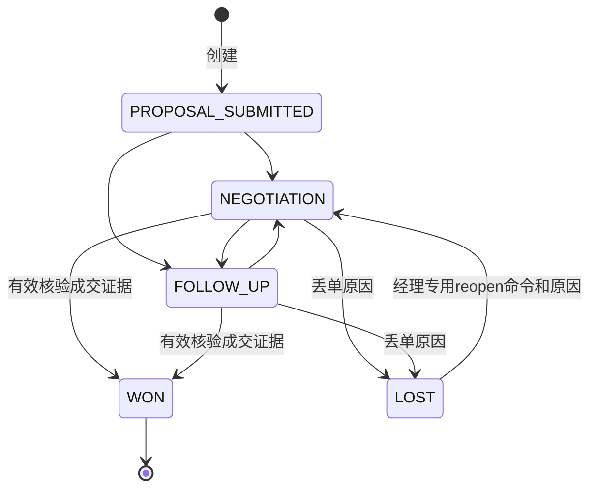
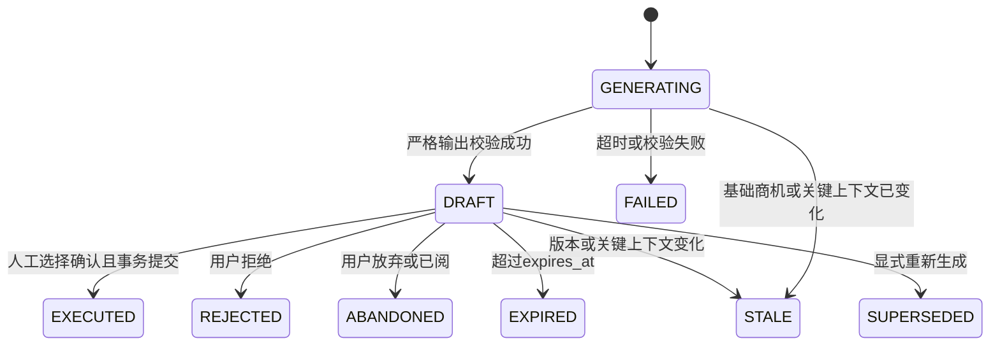

# 状态机、事务与受控执行

第二轮设计提案 v0.2 · 2026-10-26。集中领域规则是所有手动操作、批处理和AI入口的唯一权威；前端 capabilities 仅辅助展示。

实施状态：M1正式验收通过；Q03—Q06已批准；用户于2026-10-27明确授权开始M2。Q11仅成交证据PDF≤20 MiB/≤100页获批，Q12仅成交证据API代理下载、每次重新鉴权获批；Q05-A、Q07—Q10及Q11/Q12其余范围继续待确认。实施与未完成项见[M2报告](m2-report.md)，不自动进入M3。
## 1. 商机状态图

LOST 是普通转换的终态，仅专用重开命令可离开；WON 永远不可重开。归档不是第六种阶段。

## 2. 完整转换矩阵

Q06已批准集中概率映射：PROPOSAL_SUBMITTED=20、NEGOTIATION=60、FOLLOW_UP=40、WON=100、LOST=0（%）。创建/转换/重开由可信后端同事务更新并用CHECK保证阶段一致；人工及AI不能覆盖。金额计算Decimal、ROUND_HALF_UP到两位小数；amount未知则weighted_amount为null，按币种汇总；这些是固定业务配置，不是经历史数据校准的预测。

表中“—”为拒绝，相同状态不是合法状态转换，不产生额外版本；重复请求用相同幂等键重放既有结果。

| 当前\目标 | PROPOSAL_SUBMITTED | NEGOTIATION | FOLLOW_UP | WON | LOST |
| --- | --- | --- | --- | --- | --- |
| PROPOSAL_SUBMITTED | — | 允许 | 允许 | — | — |
| NEGOTIATION | — | — | 允许 | 有证据且经理 | 有原因且经理 |
| FOLLOW_UP | — | 允许 | — | 有证据且经理 | 有原因且经理 |
| WON | — | — | — | — | — |
| LOST | — | 仅专用reopen | — | — | — |

| 命令 | 调用权限 | 必填条件 | 同事务结果 |
| --- | --- | --- | --- |
| 创建 | REP自己；经理/ADMIN可指派 | 有效客户/负责人、字段有效 | stage=PROPOSAL_SUBMITTED，probability=20，version=1，创建审计 |
| 开放阶段转换 | 自己商机REP或经理/ADMIN | expected_version、target、reason非空≤2000 | stage与概率映射更新，version+1，转换审计 |
| 关闭WON | 经理/ADMIN | expected_version、证据ID、reason、所选核验证据实际amount>0、币种符合Q05规则；预计amount可未知/零/不同 | stage=WON、p=100、closed_at/by、evidence_id、version+1、审计 |
| 关闭LOST | 经理/ADMIN | expected_version、close_reason_code、close_reason非空 | stage=LOST、p=0、closed_at/by、version+1、审计 |
| 重开LOST | 经理/ADMIN专用接口 | expected_version、reason非空，未归档 | stage=NEGOTIATION、p=60，清空当前关闭字段，version+1，独立REOPEN审计 |
| 归档/取消归档 | 经理/ADMIN | expected_version，商机为终态 | 仅归档字段/version变化、审计，不更改stage |

重开不改amount/currency/owner/预计日期，历史丢单原因留在追加式审计中，当前close_reason/closed_at/closed_by/close_evidence_id清空；预计日期若已过期在UI提示。归档LOST先取消归档才能重开，两个命令各自版本化审计。WON拒绝逻辑也适用于ADMIN；无“超级管理员绕过状态机”。

普通PATCH拒绝stage、probability、weighted_amount、closed_at/by、close_evidence等字段；终态普通PATCH一律拒绝。经理变更负责人也只对开放商机允许，保证关闭记录不可悄悄改写。活动追加与证据历史读取可用于终态。

## 3. 成交证据流程

Q05已批准类型为SIGNED_CONTRACT/PURCHASE_ORDER/OTHER_APPROVED；商机和证据币种默认CNY，白名单CNY/USD/EUR/HKD。OTHER_APPROVED须明确批准依据，审批责任/步骤仍待Q05-A：建议复用approval_basis与review审计记录批准人/时间/决定引用，无通用审批工作流；未确认规则前该类型核验/关闭建议409 OTHER_APPROVAL_POLICY_PENDING，PENDING候选可保留。该分支提案不影响合同/PO流程。

1. 对有写权限的开放商机上传PDF，校验大小/MIME/文件头/页数/hash，原件存私有不可覆盖对象；StoredObject必须AVAILABLE。
2. 提交SIGNED_CONTRACT、PURCHASE_ORDER或OTHER_APPROVED，包含编号、客户法律主体、文档日期、金额、币种；其他依据附明确批准说明。
3. 有效且具对象/核验操作权限的另一位经理/ADMIN查看原件并执行review命令（VERIFY/REJECT），先校验角色/权限，再校验submitted_by != 当前用户；前者不满足403 FORBIDDEN，后者不满足403 EVIDENCE_REVIEWER_CONFLICT，ADMIN也适用。仅PENDING可审核；填写verification_note，事务内记录reviewed_by/reviewed_at、status结果、依据、version+1及审计。REP不可核验，AI/client boolean不可生成VERIFIED；人工核验不是法律认证。
4. 关闭事务锁定并复核evidence属于该商机、未拒绝、VERIFIED、证据实际amount>0、证据币种与商机currency一致（Q05已批准）、原件元数据AVAILABLE；不做外部网络请求。核验后证据内容和原件不可改删；如发现错误提交新证据并保留历史，不自动推翻已WON结果。
5. WON/LOST关闭权限统一为经理/ADMIN；REP只能准备资料和申请经理处理。Q04已批准提交人不得核验自身证据，核验人须为另一位有权限经理/ADMIN；职责分离比较提交人与核验人，关闭仍按本节权限和状态机处理；电子签认证、部分成交分摊属后续增强。
6. 预计金额未知、零或与实际合同不同仍可合法成交，保留预计值，不自动改写。actual_amount/actual_currency只投影选定核验证据；不将预计加权金额称作实际收入。币种不符拒绝，不比较金额大小、不相加、不换汇；用户可在开放阶段经CAS明确纠正币种再重新审核关闭。
7. 允许保存多份候选；仅WON命令原子写入唯一close_evidence_id，上传/核验不自动选择、不累加证据金额。所选证据还须有不同于提交人的合法核验人及记录。核验后不再修改内容；若商机币种改变，旧证据不匹配则不能关闭。
8. 选定与状态/version/审计同事务提交；同键同body重放原结果，同键改选择409 IDEMPOTENCY_KEY_REUSED。不同键旧版本409 VERSION_CONFLICT，当前版本再选同证据或换证据均422 TERMINAL_OPPORTUNITY；两个候选并发关闭至多一个成功。不存在绕过状态机的独立选择/PATCH入口。

## 4. 普通命令的事务算法

建议MySQL READ COMMITTED；所有命令使用单个SQLAlchemy Session和显式UoW `Session.begin()`；异常退出回滚。repository只能flush/execute，不能commit，HTTP成功响应仅在commit后构建。SQLAlchemy支持事务上下文管理，失败Session须回滚/丢弃后才可继续。[SQLAlchemy官方事务说明](https://docs.sqlalchemy.org/en/20/orm/session_basics.html)

以下是设计级伪流程，不是可运行代码：

1. API严格解析字段/版本/幂等键，认证当前会话；分配request_id。
2. 开启短事务，在事务内重新校验当前有效User及角色；命令根据需要锁定相关User/Account，再进入幂等和聚合操作。业务关联锁顺序见下文。
3. 幂等命令先在SAVEPOINT内尝试插入(actor,scope,key,request_hash,IN_PROGRESS)，唯一冲突等待原事务完成，回滚该SAVEPOINT后用当前读SELECT FOR UPDATE读取已提交结果，不得让IntegrityError后的失效Session继续工作。首次请求若已回滚则本次插入可成功。重放前仍检查身份/权限。相同hash返回原状态码/body；不同hash返回409 IDEMPOTENCY_KEY_REUSED。处理中行不可单独commit。
4. 读取商机及需要关联资料，先检查对象/操作权限，再检查expected_version（不符409 VERSION_CONFLICT），然后检查归档、当前stage、必要字段。读取可提供业务错误，但不能替代最终CAS。
5. 原子UPDATE必须包含 id=:id AND version=:expected_version，以及本命令期望stage/owner；SET version=version+1和业务字段，检查affected_rows恰为1。
6. affected_rows=0时不写成功审计、不保存成功幂等结果，回滚；按可见性返回404/403/409 VERSION_CONFLICT。冲突响应只在有权限时提供current_version，不能泄露不允许读取的数据。
7. 以读取的expected版本快照和本次更新结果形成白名单before/after，插入AuditEvent，mutation_event_key唯一；同事务存储幂等响应。
8. commit成功再返回；审计/约束/提交失败均rollback。客户端遇到提交结果未知，用原幂等键查询/重试；不得自动用新version重放业务意图。

CAS的概念条件为：更新指定id与期望版本，必要时匹配原stage和owner，递增version。即使预读了版本或持有行锁，也不能改成无条件UPDATE。数据库生成weighted_amount，事务内读取最终生成值用于响应与审计。

### 锁序与身份变化

统一顺序：有效User（涉及多用户按id排序）→ Account（涉及多个按id排序）→ IdempotencyRecord → AISuggestion（若有）→ Opportunity → CloseEvidence → Activity。读取只为展示的不加锁；更改owner/用户停用/证据核验等命令遵循相同关联锁序。Account停用与商机创建/推进先锁Account，避免“检查无开放商机后被并发新建”。活动创建/编辑需先锁Opportunity并在事务中检查digest相关数据，和AI apply串行协调。

建议与商机在生成阶段不持长锁。管理员停用User同样取该User行锁，确保并发执行要么在停用前完整提交，要么在停用后拒绝。死锁不可完全消除，数据库deadlock映射为409 RETRYABLE_TRANSACTION_CONFLICT；仅在确认已回滚且带幂等键的短事务允许最多一次内部重试；锁等待超时映射503并标retryable，不无限重试。最后管理员保护在专用guard锁内单独规范锁序并测试，不能和通用业务变更混用多聚合批事务。

## 5. AI建议生命周期

以下可执行字段白名单细节仍待Q07确认；probability禁止人工/AI覆盖按已批准Q06执行。本轮不实现此流程。

所有右侧终态不可再次应用；FAILED重新生成得到新建议ID。执行中不持久化ACCEPTED/EXECUTING：人工接受和业务应用在同一短事务完成，避免“已接受但永远没执行”的悬挂状态；并发请求在建议行锁等待。AuditEvent保留review与execution两个动作，即使同一次提交。

执行校验失败分两类：权限不足/字段选择错误是请求失败，草稿不变；过期或数据变化将草稿变EXPIRED/STALE并写审计，返回409/410，没有任何CRM副作用。瞬态数据库故障保留DRAFT与脱敏失败尝试信息供同键重试，不能因为短时故障永久消耗草稿；永久已确定不合法的冻结提议可标FAILED要求重新生成。若业务事务已回滚，失败状态用全新Session短事务有条件写入，只能更新仍为DRAFT的建议，绝不能覆盖已并发EXECUTED状态。错误日志无法写入不改变CRM回滚事实。

### 应用建议事务

1. 认证、校验CSRF和Idempotency-Key，锁相关User/Account、幂等记录和AISuggestion；先检查当前权限，再处理已执行结果重放。
2. 检查suggestion.version、status=DRAFT、服务端时间<expires_at、用户拥有目标写权限；selected_change_ids必须非空、存在且符合dependency_group。客户端提交的expected_opportunity_version必须等于base版本。
3. 锁Opportunity，检验version=base版本、未关闭/归档；按固定顺序读取/锁定相关Activity，重算context_digest。活动相关字段改变则STALE，即使商机版本未变。
4. 验证冻结before和当前值一致，逐字段FACT证据、联系人归属/有效性、金额币种组合、开放阶段状态机；禁止字段白名单以外更新，禁止WON/LOST、owner、概率、成交证据。
5. 使用CAS更新商机并version+1。仅追加活动的建议也CAS递增商机version，作为一次受控执行的业务锚点；AI生成本身不更改version。
6. 为选择的NOTE/TASK创建Activity，(suggestion_id,change_id)唯一。选中项全部成功或全部失败；AI工具不能发真实邮件或调用任意URL。
7. 同事务追加商机/活动变更、SUGGESTION_REVIEWED和SUGGESTION_EXECUTED审计，写reviewed_by/at、execution_id、selected IDs、result_version，建议status=EXECUTED和version+1；完成幂等记录并commit。
8. 重复相同key重放原结果；不同key但建议已EXECUTED返回既有execution结果，仅当选择hash一致，选择不一致返回409 SUGGESTION_ALREADY_EXECUTED。不再新增活动/审计副作用。

选中项被执行后未选择项不可再次执行；重新生成需要新草稿。真实模型结果与Mock草稿相同地走审核流程，但UI/响应/审计都带mode，生产配置可禁止Mock执行。

## 6. 幂等边界

| 场景 | 策略 |
| --- | --- |
| 状态关闭、重开、AI apply | 必须Idempotency-Key，建议UUID，最多128字符，作用域含actor/route/object |
| 一般开放阶段转换/归档/证据核验 | 同样要求键，统一命令交互，避免用户重复点击 |
| 普通字段PATCH | expected_version；超时重读，不搭建全局请求去重框架 |
| 普通创建Account/Opportunity/Activity | 不承诺幂等；提交中禁重复，超时查询确认后再操作；AI创建Activity另有唯一保护 |
| GET、列表、统计 | 无幂等记录，无副作用 |
| 生成任务 | 客户端request_token + Job dedupe_key，重试拿同一job，不重复计费生成请求 |
| 文档上传 | 上传请求token去重、固定object key；失败可重试；不是按文件hash去掉所有同内容业务文档 |

幂等记录保存7天，存同事务成功结果；确定的409/422通常不保存成功结果，失败结果可从operation attempt诊断。相同键不同payload必拒绝，不能借幂等缓存忽略权限变化。首次请求提交后响应丢失，重试只能有一次版本递增和一次主审计。

## 7. 审计核验与异常测试

| 场景 | 预期 |
| --- | --- |
| Proposal直接WON/LOST | 422 INVALID_STAGE_TRANSITION；version和审计不变 |
| WON/LOST普通PATCH/transition | 422 TERMINAL_OPPORTUNITY；不能改字段 |
| WON专用reopen | 422 WON_REOPEN_NOT_ALLOWED，ADMIN亦拒绝 |
| LOST重开无原因/REP调用 | 422 / 403；无业务写入 |
| 错误/未核验/其他商机证据 | 422 EVIDENCE_INVALID；保持开放阶段 |
| 预计金额未知/零/与实际不同 | 满足其余条件允许WON，预计值保留，实际投影所选证据 |
| 实际金额<=0或未核验 | 422 EVIDENCE_INVALID；无成功副作用 |
| 证据币种与商机不同 | 422 EVIDENCE_CURRENCY_MISMATCH；不换汇/自动改币种 |

| 自核验/核验角色或对象操作越权 | 分别403 EVIDENCE_REVIEWER_CONFLICT / FORBIDDEN；证据、商机、版本和成功审计不变 |
| 再选证据/并发不同候选关闭 | 相同键重放；不同键旧版本409 VERSION_CONFLICT、当前终态422 TERMINAL_OPPORTUNITY；仅一份被选 |
| 人工或AI覆盖probability | 422 FIELD_NOT_EDITABLE；Provider非法提议为Job.error=AI_OUTPUT_INVALID，无可执行草稿 |
| 同version两请求 | 最多一次成功；另一个409；只有一个resulting_version和主审计 |
| 审计INSERT注入失败 | 500 INTERNAL_ERROR；数据库状态、version、建议、活动、幂等成功结果全部不变 |
| 建议过期/上下文改变/商机改变 | 410 SUGGESTION_EXPIRED / 409 SUGGESTION_STALE；无CRM副作用 |
| 不同键重复执行同一建议 | 同选择重放结果，改选择409；Activity和审计不重复 |
| 数据库提交成功但响应断连 | 原key重试200及原result_version；不再更新 |

审计对账：每条商机版本n（创建为1）应有唯一mutation_event_key，前事件after与后事件before关键字段连续；关闭/重开审计包含reason、expected/resulting version和actor。后台对账发现缺口报警，不自动补造“历史成功”。MVP不以数据库外日志代替事务内审计。
